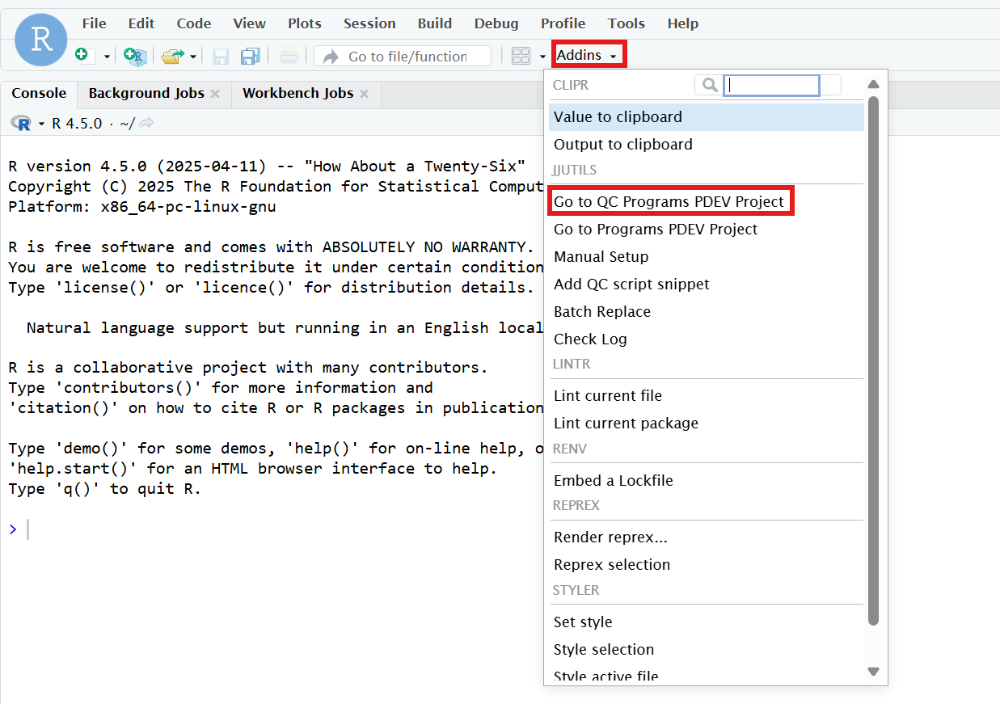
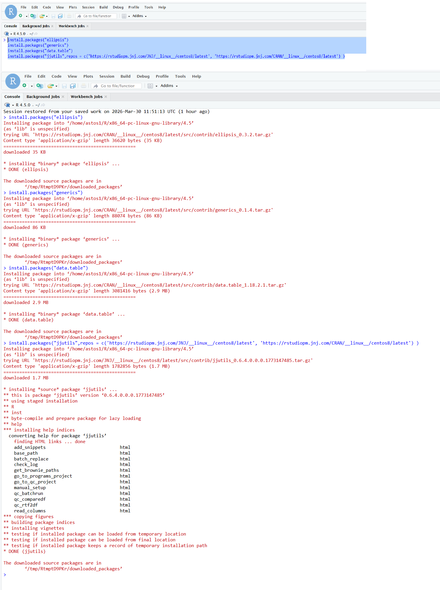
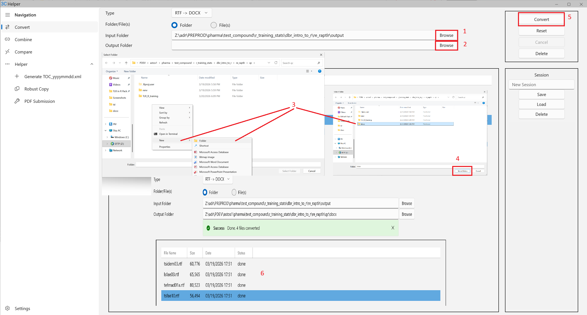
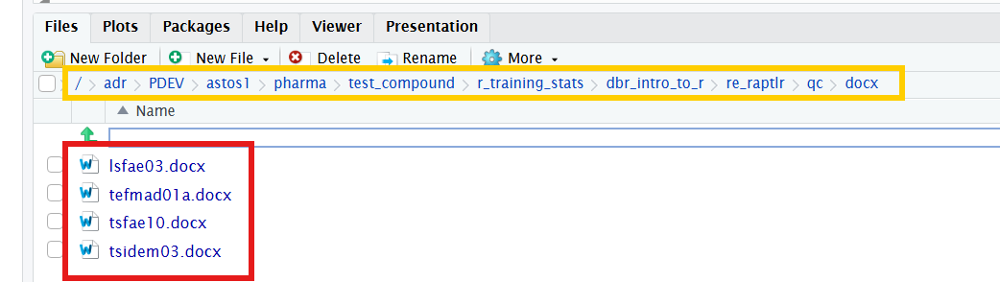

# Output Conversion with 3C Helper {#output-conversion}

## Understanding TLF Formats

RapTLR's `run_apdx()` function inserts TLFs into your Word document. To work properly, your outputs must be in **.DOCX format**. As outputs are generally .RTF they need to be converted as .DOCX and for that the tool **3C Helper** is used.

## What is 3C Helper?

3C Helper is a companion tool that converts various output formats to .DOCX.\
The purpose of this tool is to convert your RTF outputs generated by SAS into DOCX and use them to create for each a bookmark and incorporate them into the TLR document.

## How to download 3C Helper

You can download 3C Helper on [this page](https://idarconnect.jnj.com/downloads/) and click on `Download 3C Helper, version 2.1.5`.\
If needed you can read the user guide in Confluence on [this page](https://confluence.jnj.com/spaces/AHWD/pages/364845581/3C+Helper+v2.x+User+Guide).

## Converting your RTF outputs into DOCX

### Example from the TLR package

In the R package we provided dummy rtf outputs that you can use to practice with 3C Helper. They are also accessible [here](https://jnj.sharepoint.com/teams/TLRinRPackage/Shared%20Documents/Forms/AllItems.aspx?id=%2Fteams%2FTLRinRPackage%2FShared%20Documents%2FGeneral%2FPackage%20Material%2FDummy%20%2ERTF%20Outputs&viewid=8237c82f%2D411b%2D479b%2D9ce0%2D6d46e9d85662&csf=1&CID=3e740844%2Db277%2D4c4e%2Da316%2Da9c32d904883&FolderCTID=0x01200033BBBD2357830A4B87F02E31F18B1C71). 

You can use the function `import_RTFs()` to copy and create a clone folder of dummy rtf outputs in your working directory. See below. \

```{r eval=FALSE}
library(RapTLR)
import_RTFs()
```

If succeeded in your console you should receive this message: `[INFO] rtf_outputs folder has been successfully imported and copied under: ...`\

### How to use 3C Helper: 

After having imported the .RTF outputs, the next step is to convert them to .DOCX format

1. Open 3C Helper
2. Select **Convert** in the sidebar 
3. Type: **RTF -> DOCX**
4. Folder/File(s): **Folder**
5. Input Folder: **Provide a folder path of .RTF outputs (like the one created above)**
6. Output Folder: **Whatever folder where you want your new converted .DOCX outputs**
7. Click **Convert**

### Summary video (no sound)

The following recording shows in details how to use the `import_RTFs()` function and 3C Helper to convert RTF outputs into DOCX format.

<video width="640" height="480" controls>

<source src="videos/demo_3CHelper.mp4" type="video/mp4">

</video>

## Working with SPACE 

When creating your TLR, the outputs should be saved in SPACE under PREPROD or PROD. When you connect your R Session to the corresponding RE, R automatically creates "libpaths" that you can use to access the different folders and pillar.

In the following steps, we are trying to imitate a proper study structure.


### Accessing the Report Effort and Connect to R

The first step is to get access to the compound called `test_compound` in SPACE.\

To have access, you need to summit this [SAM request](https://sam1.service-now.com/sam?id=sc_cat_item&sys_id=82783e8c1bd26410328c2f4aab4bcbe4&sysparm_category=f33512a2dbf5681000bd177e169619e2): \

1. Select Environment: **PROD**
2. Request Type: **Add Access**
3. Compound: **test_compound**
4. Therapeutic Area: **None** -> Click on `Other TA`
5. Other TA: **Test_compound access**
6. Selecting Existing SPACE User: **Find yourself**
7. Add attachments: **Provide a word document with the sentence: *Accessing test_compound***

Once you have access, go to (**Do not forget to assign yourself at every step: ACTIONS -> Assign myself**): 

1. `test_compound`
2. `r_training_stats`
3. `dbr_intro_to_r`
4. `re_raptlr` 

Don't forget to assign yourself and then click on `ACTIONS -> Launch R Studio`

5. Enter your JnJ Credentials
6. Start a `New Session` then click `Start Session`
7. Click on `Addins` then click `Go to QC Programs PDEV Project` (If you don't see it, go to 8). If R asks you if want to save your workspace, click `Don't Save`.

```{r, echo=FALSE, out.width='80%', out.height='80%', fig.align='center'}

```


8. In case you don't see `Go to QC Programs PDEV Project`, you need to install the following R packages: 

```{r, echo=TRUE, eval = FALSE}
install.packages("ellipsis")
install.packages("generics")
install.packages("data.table")
install.packages("jjutils", repos = c("https://rstudiopm.jnj.com/JNJ/__linux__/centos8/latest", "https://rstudiopm.jnj.com/CRAN/__linux__/centos8/latest"))
```


```{r, echo=FALSE, out.width='80%', out.height='80%', fig.align='center'}

```

After R has downloaded all the required packages, you should be able to proceed to step 7. 


### How to convert outputs in SPACE

In SPACE under `OUPUTS & ANALYSIS` from `re_raptlr` there are five .RTF dummy outputs available (`tsidem03, tefmad01a, tsfae10, tsfae10_c, lsfae03`) for conversion using 3C Helper.

3C Helper uses RaiDrive to access the outputs, and in the following steps, Z:\ refers to the RaiDrive drive mapping.

1. Open 3C Helper
2. Select **Convert** in the sidebar 
3. Type: **RTF -> DOCX**
4. Folder/File(s): **Folder**
5. Input Folder: Select folder **rtf** in `Z:\adr\PREPROD\pharma\test_compound\r_training_stats\dbr_intro_to_r\re_raptlr\output` -  **Be sure to use your JnJ Credential**
6. Output Folder: Create folder **docx** and select in `Z:\adr\PDEV\astos1\pharma\test_compound\r_training_stats\dbr_intro_to_r\re_raptlr\qc\docx` - **Be sure to use your JnJ Credential**
7. Click **Convert**

```{r, echo=FALSE, out.width='80%', fig.align='center'}

```

The new .DOCX outputs should be available your R session as well.

```{r, echo=FALSE, out.width='80%', fig.align='center'}

```


### Summary video (no sound)


### Notes 

- Be aware that the destination of the outputs should always be under `OUTPUTS & ANALYIS` but they could be under `PREPROP` or `PROD`
- Do not forget to `Assign myself` at every level 
- Be careful to use the correct path between SPACE and RaiDrive
- It's possible that the Reporting Effort has not been set up for R before, you will get an error message saying: `Error: Did you setup your Programs PDEV?`. Contact the study lead programmer. 
- If you need more guidance about R in SPACE, you can access the [Confluence](https://confluence.jnj.com/spaces/VALR/pages/275491188/R+in+SPACE) page
